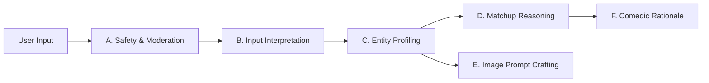

# IDIOT SANDWICH — AI System Specification

> Architectural design for LLM responsibilities, prompt categorization, schema-enforced structured outputs, and safety boundaries.

---

## 🧠 Core Philosophy: AI as an Advisory Subsystem

In Idiot Sandwich, the AI does **not** command the application lifecycle. Instead, it acts as a specialized advisory engine for semantic comprehension, creative synthesis, and humorous adjudication.

All AI interactions must adhere to three foundational rules:
1. **Strictly Structured JSON:** Never stream or parse freeform conversational text for game state logic.
2. **Deterministic Encasement:** AI outputs are validated by engine invariants before applying mutations.
3. **Idempotency & Caching:** Identical queries should produce predictable results via semantic caching.

---

## 📋 Categorized AI Responsibilities



---

### Category A: Input Interpretation & Normalization
**Goal:** Translate idiosyncratic player inputs into a clean semantic entity.

- **Sample Input:** `"my grandma's 1994 corolla that refuses to die"`
- **Extracted Metadata:**
  - `canonicalName`: `"1994 Toyota Corolla"`
  - `qualifiers`: `["indestructible", "vintage", "reliable"]`
  - `category`: `"Physical Vehicle"`
  - `entityDomain`: `"Mechanical / Mundane"`

---

### Category B: Entity Profiling (Proposed Dimensions)
**Goal:** Estimate relative scale and capability indicators.

*Note: Attributes are speculative and subject to refinement.*
```json
{
  "scaleTier": "human-scale",
  "destructivePotential": 24,
  "durability": 88,
  "conceptualNature": "physical-object",
  "archetypeTags": ["machine", "stubborn", "metal"]
}
```

---

### Category C: Matchup Reasoning & Adjudication
**Goal:** Compare the Reigning Champion against the Challenger.

- **Inputs to Model:**
  - Champion Profile (e.g., `Nuclear Bomb Sandwich`)
  - Challenger Profile (e.g., `Black Hole Sandwich`)
  - Contextual History (optional defense streak context)
- **Model Mandate:**
  - Weigh physical destruction vs. conceptual scale vs. comedic poetic justice.
  - Determine a victor (`champion` vs. `challenger`).
  - Score internal decision confidence (0.00 – 1.00).

---

### Category D: Explanation & Narrative Generation
**Goal:** Provide an entertaining, punchy, and funny 1–2 sentence battle summary.

- **Tone Guidelines:** Witty, confident, slightly unhinged, leaning into culinary satire.
- **Example:**  
  > *"While the 1994 Corolla Sandwich possesses legendary endurance, the Nuclear Bomb Sandwich detonates with 50 megatons of toasted flavor, vaporizing the chassis down to bare crumbs."*

---

### Category E: Image Prompt Generation
**Goal:** Transform an abstract or literal entity into a prompt optimized for image generation models (see [IMAGE_SYSTEM.md](./IMAGE_SYSTEM.md)).

- **Prompt Blueprint:**
  - Sandwich construction (two slices of bread / buns encapsulating the entity).
  - Material manifestation (e.g., molten lava oozing between toasted sourdough).
  - Lighting, perspective, and satirical studio food photography style.

---

### Category F: Safety, Moderation & Guardrails
**Goal:** Protect players and infrastructure from toxic, abusive, or malicious prompts.

- **Pre-Execution Check:** Automated check for hate speech, severe profanity, non-consensual sexual content, self-harm, or illegal acts.
- **Prompt Injection Defense:** Strict delineation between user-supplied strings and system instructions. User input is treated strictly as an untrusted parameter string.

---

## 📐 Structured Output Schema Requirement

Under no circumstances should the backend parse unstructured natural language such as:
> *"I think the challenger wins because nuclear bombs are super strong..."*

All adjudication calls require a validated JSON schema. Below is the proposed evaluation contract:

```typescript
export interface MatchupEvaluationResponse {
  winner: "champion" | "challenger";
  confidence: number; // 0.00 to 1.00
  shortHeadline: string; // e.g. "Vaporized by Toasted Radiance"
  humorousReason: string; // 1-2 punchy sentences
  dominantFactor: "scale" | "destruction" | "elemental_counter" | "ironic_absurdity" | "cosmic_supremacy";
  challengerProfile: {
    canonicalName: string;
    sandwichDescription: string;
    powerRatingEstimate: number; // 1 to 100
  };
}
```

### Illustrative Payload Example

```json
{
  "winner": "challenger",
  "confidence": 0.96,
  "shortHeadline": "Event Horizon Consumes the Toast",
  "humorousReason": "A nuclear explosion is undeniably fierce, but a black hole sandwich pulls the blast, the bread, and the space-time continuum itself straight into infinite sourdough density.",
  "dominantFactor": "cosmic_supremacy",
  "challengerProfile": {
    "canonicalName": "Supermassive Black Hole",
    "sandwichDescription": "Two swirling cosmic crusts pinching a singularity of crushed matter and dark mayo.",
    "powerRatingEstimate": 99
  }
}
```

---

## 🔗 Related Documentation

- Visual rendering pipeline: [IMAGE_SYSTEM.md](./IMAGE_SYSTEM.md)
- Security & prompt injection defense: [SECURITY.md](./SECURITY.md)
- Token cost projections: [COSTS.md](./COSTS.md)
- Engine rules validation: [GAME_ENGINE.md](./GAME_ENGINE.md)
