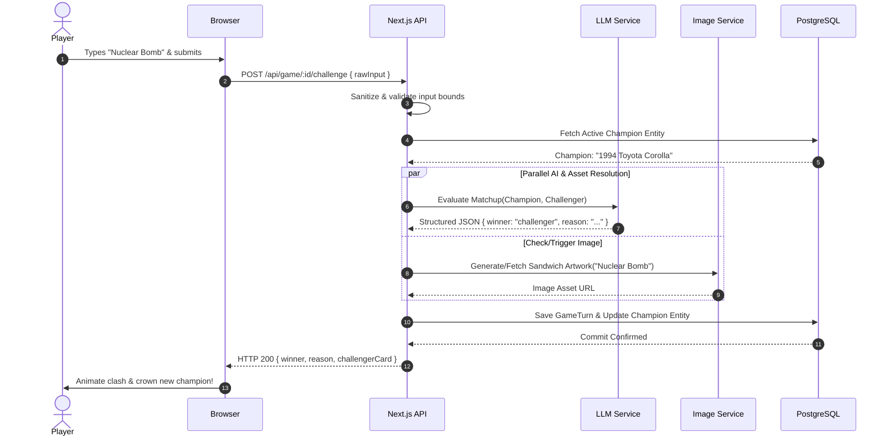

# IDIOT SANDWICH — System Architecture

> Structural architecture, candidate technology stack, data flow pathways, and evaluated alternatives. All technical choices are proposed baselines.

---

## 🏗️ High-Level System Architecture

```text
                    ┌───────────────┐
                    │    Browser    │
                    └───────┬───────┘
                            │ (HTTPS / JSON)
                            ▼
                    ┌───────────────┐
                    │    Next.js    │ (App Router / Server Actions)
                    └───────┬───────┘
                            │
              ┌─────────────┼─────────────┐
              ▼             ▼             ▼
        ┌──────────┐  ┌──────────┐  ┌───────────┐
        │   Game   │  │    AI    │  │   Image   │
        │  Engine  │  │ Service  │  │  Service  │
        └────┬─────┘  └──────────┘  └───────────┘
             │
             ▼
        ┌──────────┐
        │PostgreSQL│ (Drizzle ORM)
        └──────────┘
```

---

## 🛠️ Preferred Technology Stack (Proposed)

| Layer | Proposed Choice | Primary Rationale | Evaluated Alternatives |
| :--- | :--- | :--- | :--- |
| **Frontend Framework** | **Next.js (App Router) + TypeScript** | React ecosystem, server-rendered landing, fast client interactions, co-located API routes. | Vite + React SPA, SvelteKit, Astro |
| **Backend / API** | **Next.js Server Functions / Route Handlers** | Single unified codebase, fast serverless execution, minimal deployment overhead for MVP. | Express / Fastify on Node, Go backend, FastAPI |
| **Database** | **PostgreSQL** | Relational integrity for turn trees, JSONB support for dynamic AI entity attributes. | SQLite (Turso), Supabase, MongoDB |
| **ORM / Data Access** | **Drizzle ORM** | Type-safe, lightweight, zero-dependency overhead, seamless migrations. | Prisma, Kysely, Raw SQL |
| **AI LLM Inference** | **External Structured LLM API** | Fast structured JSON output, strong reasoning, cost-effective semantic interpretation. | Self-hosted Ollama, fine-tuned SLM |
| **Image Generation** | **External GenAI Image API** | High-fidelity food surrealism, robust safety filters. | Self-hosted Stable Diffusion / Flux |
| **Asset Storage / CDN** | **Cloudflare R2 / AWS S3** | S3-compatible, low-cost egress for cached sandwich imagery. | Vercel Blob, Supabase Storage |
| **Hosting & Deployment** | **Vercel** | Turnkey Next.js deployment, automatic edge caching, global distribution. | Fly.io, Railway, AWS ECS |

---

## 🔄 End-to-End Data Flow



---

## ⚖️ Architectural Trade-Offs & Decisions

1. **Monolith vs. Microservices:**
   - *Decision:* Unified Next.js application.
   - *Rationale:* For an experimental project, microservices introduce unnecessary network serialization, deployment overhead, and operational latency.
2. **Synchronous vs. Asynchronous Turn Resolution:**
   - *Decision:* Hybrid. The text evaluation is synchronous (`<2s`), while image generation can resolve optimistically with fallback loading states.
3. **Database Selection:**
   - *Decision:* PostgreSQL with `JSONB` flexibility.
   - *Rationale:* Structured relational turns prevent orphaned records, while `JSONB` gives the AI room to attach experimental attributes without requiring schema migrations on every tweak.

---

## 🔗 Related Documentation

- Database schema details: [DATA_MODEL.md](./DATA_MODEL.md)
- AI integration patterns: [AI_SYSTEM.md](./AI_SYSTEM.md)
- Security boundaries: [SECURITY.md](./SECURITY.md)
- Architectural Decision Records: [DECISIONS.md](./DECISIONS.md)
