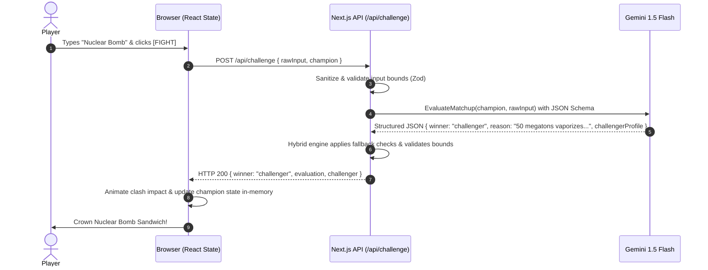

# IDIOT SANDWICH — System Architecture

> Structural architecture, accepted technology stack, data flow pathways, and operational design.

---

## 🏗️ High-Level System Architecture

```text
                    ┌─────────────────────────┐
                    │         Browser         │
                    │ (React 19 / State Store)│
                    │  - Current Champion     │
                    │  - Battle History & Run │
                    └────────────┬────────────┘
                                 │ (HTTPS / JSON)
                                 ▼
                    ┌─────────────────────────┐
                    │    Next.js Route API    │
                    │   (/api/challenge)      │
                    │  - Input Sanitization   │
                    │  - Secret Key Custody   │
                    └────────────┬────────────┘
                                 │
                   ┌─────────────┴─────────────┐
                   ▼                           ▼
             ┌──────────┐                ┌───────────┐
             │   Game   │                │  Google   │
             │  Engine  │                │  Gemini   │
             │ (Hybrid) │                │ 1.5 Flash │
             └──────────┘                └───────────┘
```

---

## 🛠️ Finalized Technology Stack (Accepted)

| Layer | Accepted Choice | Primary Rationale | Reference |
| :--- | :--- | :--- | :--- |
| **Frontend Framework** | **Next.js (App Router) + TypeScript + React 19** | Modern React ecosystem, fast client interactions, co-located edge/serverless route handlers. | [DEC-007](./DECISIONS.md#dec-007) |
| **Backend / API** | **Next.js Route Handlers (Stateless Proxy)** | Single unified codebase, fast serverless execution, protects server-side `GEMINI_API_KEY`. | [DEC-007](./DECISIONS.md#dec-007) |
| **State & Persistence** | **Zero-DB (In-Memory React State + LocalStorage)** | Game is a casual one-time session loop. Zero database overhead, zero maintenance, zero cold-starts. | [DEC-014](./DECISIONS.md#dec-014) |
| **AI LLM Inference** | **Google Gemini 1.5 Flash** | Sub-second latency, lowest token cost, strict JSON schema output via structured schema. | [DEC-010](./DECISIONS.md#dec-010) |
| **Scoring Engine** | **Option C: Hybrid AI + Rule Guardrails** | AI evaluates clash; engine enforces deterministic invariants, tiebreakers, and offline fallback. | [DEC-011](./DECISIONS.md#dec-011) |
| **Image Pipeline** | **Curated Visual Assets + Stylized Cards** | Instant clash resolution with dynamic stylized cards and curated visual mappings. | [DEC-013](./DECISIONS.md#dec-013) |
| **Hosting & Deployment** | **Vercel** | Turnkey Next.js deployment, automatic edge caching, global distribution. | [DEC-007](./DECISIONS.md#dec-007) |

---

## 🔄 End-to-End Data Flow (Stateless Flow)



---

## ⚖️ Architectural Invariants

1. **Decoupled Resolution:** Text adjudication never blocks on image generation. Battles resolve within <1 second.
2. **Server-Side API Keys:** Gemini API keys, database connection strings, and storage credentials never touch the browser bundle.
3. **Immutable History:** Past `GameTurn` records are append-only and strictly preserved for lineage reels.

---

## 🔗 Related Documentation

- AI orchestration: [AI_SYSTEM.md](./AI_SYSTEM.md)
- Image generation strategy: [IMAGE_SYSTEM.md](./IMAGE_SYSTEM.md)
- Database schema details: [DATA_MODEL.md](./DATA_MODEL.md)
- Architectural Decision Records: [DECISIONS.md](./DECISIONS.md)
