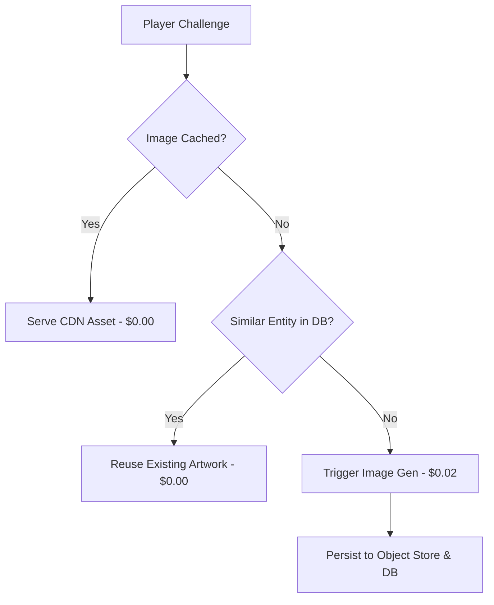

# IDIOT SANDWICH — Financial & Cost Optimization Model

> Analysis of operational cost drivers, economic vulnerability assessments, caching heuristics, and mitigation strategies.

---

## 💸 Cost Driver Breakdown

An open-ended, AI-powered web game incurs variable per-action operational costs. The primary cost drivers are ranked below by projected economic impact:

```text
┌────────────────────────────────────────────────────────┐
│             ESTIMATED RELATIVE COST PROFILE            │
├──────────────────────────┬─────────────────────────────┤
│ Component                │ Relative Cost Impact        │
├──────────────────────────┼─────────────────────────────┤
│ 1. Image Generation      │ 🔴 High (~70-85% of total)  │
│ 2. LLM Matchup Evaluation│ 🟡 Medium (~10-20% of total)│
│ 3. Database & Storage    │ 🟢 Low (~3-5% of total)     │
│ 4. Hosting & CDN Egress  │ 🟢 Low (~2-5% of total)     │
└──────────────────────────┴─────────────────────────────┘
```

---

## 🥪 Why Image Generation Dominates Costs

Generating a custom photorealistic image via modern GenAI APIs typically costs between **$0.01 and $0.04 USD per image**. In contrast:
- A structured LLM evaluation call (e.g., input classification + matchup decision) costs approximately **$0.0005 to $0.002 USD per request** using efficient modern models.
- Database read/write and CDN bandwidth cost fractions of a cent per thousand transactions.

**Takeaway:** Without rigorous caching and throttling, 10,000 un-cached turns could cost hundreds of dollars in image generation alone, compared to just $10–$20 for LLM inference.

---

## 🛡️ Cost Optimization Strategies



### 1. Canonical Image Caching & Normalization
- Map synonyms and variations to a single canonical visual asset (e.g., `"1998 Corolla"`, `"Toyota Corolla"`, and `"old Corolla"` all point to the cached `toyota_corolla.webp` asset).
- Once an entity is generated, its artwork is immutable and permanently served via low-cost CDN (e.g., Cloudflare R2 / AWS S3).

### 2. Tiered Model Invocations
- **Fast / Economical LLM for Triage:** Use ultra-fast, low-cost models (e.g., `gemini-1.5-flash` or `gpt-4o-mini`) for input sanitization, normalization, and standard matchup adjudication.
- **Complex / Flagship Model on Exception Only:** Reserve larger, expensive models solely for complex conceptual paradoxes or high-stakes championship rounds if necessary.

### 3. Matchup Result Caching
- Cache recurring entity pairings (e.g., `Onion` vs `Car`). If another player or game triggers the identical pairing, the historical verdict can be served from database cache with zero AI cost.

### 4. Asynchronous & Lazy Image Generation
- Do not block the turn on image creation. If a user rapidly enters 5 lost challengers, the game could defer rendering full visual artwork for contenders that are immediately vaporized, or render them only on demand if the player inspects the turn card.

### 5. Play Budgeting & Rate Limits
- Implement session turn limits or cooldowns (e.g., 20 free turns per session) to prevent malicious or automated script draining of API wallets.

---

## 📊 Summary of Proposed Policies (Non-Final)

- **Default Image Policy:** 1 generation per unique canonical entity, cached forever.
- **Matchup Policy:** Dynamic LLM evaluation, cached at the entity-pair level.
- **Pricing / Monetization:** Unlocked during MVP; operational telemetry will inform future sponsorship, tip-jar, or rate-limit thresholds.

---

## 🔗 Related Documentation

- Image generation pipeline: [IMAGE_SYSTEM.md](./IMAGE_SYSTEM.md)
- Rate limiting and abuse prevention: [SECURITY.md](./SECURITY.md)
- Scaled infrastructure: [ARCHITECTURE.md](./ARCHITECTURE.md)
- Open economic questions: [OPEN_QUESTIONS.md](./OPEN_QUESTIONS.md)
