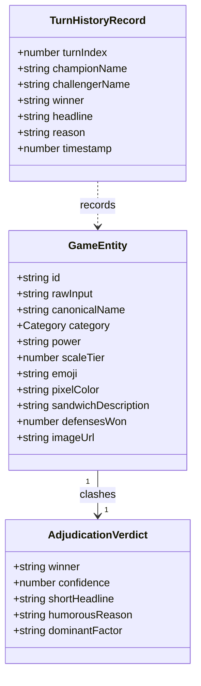

# IDIOT SANDWICH — Session Data Model (Zero-DB Architecture)

> Runtime data structures, session interfaces, and payload contracts. Under **DEC-014**, Idiot Sandwich operates on a **Zero-DB** architecture: all state lives ephemerally in client React state (with optional browser localStorage). No server-side relational database, ORM, or migrations are required.

---

## 🗺️ Architectural Context: Zero-DB Design

As codified in [DEC-014](./DECISIONS.md#dec-014), persistent databases (such as Neon PostgreSQL) have been superseded in favor of a clean, zero-maintenance runtime model:

- **Ephemeral Sessions:** The player battles through their own session ladder starting from the Humble Onion.
- **Client Custody:** Current champion, defense streaks, round counts, and match history live in the browser bundle.
- **Stateless Server Proxy:** The `/api/challenge` endpoint passes sanitized concepts to Gemini 1.5 Flash and returns structured JSON verdicts without saving state.



---

## 📦 Runtime TypeScript Interfaces

These interfaces are implemented in [`src/types/game.ts`](../src/types/game.ts):

### 1. `GameEntity`
The canonical in-memory representation of any sandwich entity (both the current champion and the challenger):

```typescript
export interface GameEntity {
  id: string;                                // e.g. "starter-onion" or generated UUID
  rawInput: string;                          // Original player text (e.g. "a 1994 toyota corolla")
  canonicalName: string;                     // e.g. "1994 TOYOTA COROLLA SANDWICH"
  category: "Mundane" | "Vehicle" | "Weapon" | "Cosmic" | "Living" | "Abstract" | "Divine";
  power: string | number;                    // Formatted power rating (e.g. "24")
  scaleTier: number;                         // Normalized tier (1 to 100)
  emoji: string;                             // Entity icon (e.g. "🚗")
  pixelColor: string;                        // Dominant card theme accent hex
  sandwichDescription: string;               // How this concept is squished into bread
  defensesWon: number;                       // Current victory streak as champion
  imageUrl?: string;                         // Static or generated sandwich visual
}
```

### 2. `AdjudicationVerdict`
The structured output produced by Gemini 1.5 Flash (validated by Zod in [`src/lib/engine/schemas.ts`](../src/lib/engine/schemas.ts)):

```typescript
export interface AdjudicationVerdict {
  winner: "champion" | "challenger";
  confidence: number;                        // 0.00 to 1.00
  shortHeadline: string;                     // Punchy summary (e.g. "Corolla Flattens the Allium")
  humorousReason: string;                    // Absurd comedic justification
  dominantFactor: "scale" | "destruction" | "elemental_counter" | "ironic_absurdity" | "cosmic_supremacy";
}
```

### 3. `TurnHistoryRecord`
Ephemeral history record stored in the client's notebook drawer:

```typescript
export interface TurnHistoryRecord {
  turnIndex: number;
  championName: string;
  challengerName: string;
  winner: "champion" | "challenger";
  headline: string;
  reason: string;
  timestamp: number;
}
```

---

## 📡 API Contract (`POST /api/challenge`)

### Request Payload:
```json
{
  "rawInput": "a black hole with an appetite",
  "champion": {
    "id": "starter-onion",
    "canonicalName": "THE HUMBLE ONION SANDWICH",
    "sandwichDescription": "Raw red onion slices clamped between toasted sourdough.",
    "category": "Mundane",
    "power": "04",
    "scaleTier": 6,
    "defensesWon": 0
  }
}
```

### Response Payload:
```json
{
  "success": true,
  "winner": "challenger",
  "isNewChampion": true,
  "evaluation": {
    "confidence": 0.98,
    "shortHeadline": "Event Horizon Consumes the Sourdough",
    "humorousReason": "The gravitational singularity effortlessly collapses onion cells and toasted sourdough into an infinitely dense cosmic spread.",
    "dominantFactor": "cosmic_supremacy"
  },
  "challenger": {
    "id": "e4a7b1...",
    "rawInput": "a black hole with an appetite",
    "canonicalName": "HUNGRY BLACK HOLE SANDWICH",
    "category": "Cosmic",
    "power": "99",
    "scaleTier": 99,
    "emoji": "🕳️",
    "pixelColor": "#1A0933",
    "sandwichDescription": "Two curving photon spheres squeezing an inescapable gravitational singularity."
  },
  "adjudicatorSource": "gemini-live"
}
```

---

## 🔗 Related Documentation

- Architectural decisions: [DECISIONS.md](./DECISIONS.md) (DEC-014)
- System architecture: [ARCHITECTURE.md](./ARCHITECTURE.md)
- Game engine pipeline: [GAME_ENGINE.md](./GAME_ENGINE.md)
- Live API spec: [API.md](./API.md)
