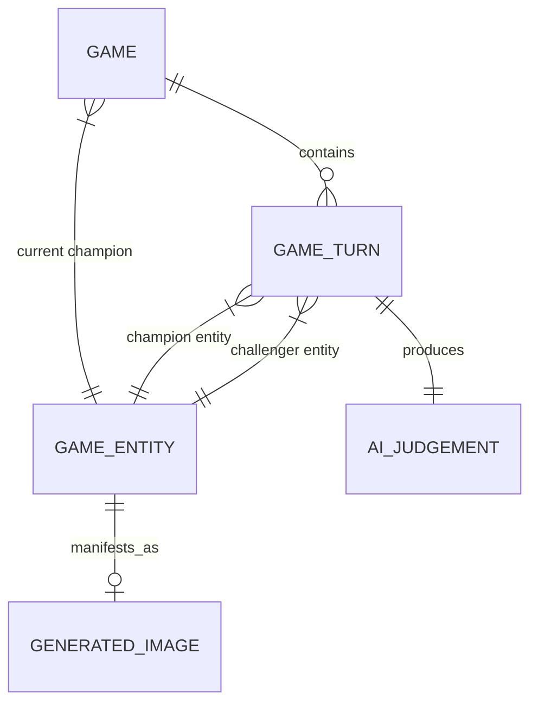

# IDIOT SANDWICH — Conceptual Data Model

> Architectural schema design, entity relationships, field definitions, and MVP vs. speculative boundaries. No physical migrations exist in this phase.

---

## 🗺️ Entity Relationship Overview

---

## 🗄️ Proposed Entity Specifications

### 1. `Game` (Active Session / Game Instance)
- **Status:** `PROPOSED (Required for MVP)`
- **Purpose:** Represents an isolated or global sequence of sandwich challenges.
- **Fields:**
  - `id`: UUID (Primary Key)
  - `slug`: String (Human-readable game code or identifier)
  - `currentChampionEntityId`: UUID (Foreign Key → `GameEntity`)
  - `turnCount`: Integer (Total turns played in this run)
  - `createdAt`: Timestamp
  - `updatedAt`: Timestamp
- **Relationships:**
  - Has many `GameTurn` records.
  - References a current champion `GameEntity`.

---

### 2. `GameEntity` (Normalized Concept)
- **Status:** `PROPOSED (Required for MVP)`
- **Purpose:** Canonical representation of an object, being, or concept submitted by players.
- **Fields:**
  - `id`: UUID (Primary Key)
  - `canonicalName`: String (e.g., `"Nuclear Warhead"`)
  - `rawInput`: String (Original player input text)
  - `category`: String (e.g., `"Weapon"`, `"Cosmic"`, `"Concept"`)
  - `domain`: String (e.g., `"Physical"`, `"Abstract"`)
  - `attributesJson`: JSONB (Scale, power estimates, comedic traits)
  - `imageId`: UUID (Nullable Foreign Key → `GeneratedImage`)
  - `createdAt`: Timestamp
- **Relationships:**
  - Belongs to zero or one `GeneratedImage`.
  - Can participate in many `GameTurn` records as champion or challenger.

---

### 3. `GameTurn` (Turn Record / Clash)
- **Status:** `PROPOSED (Required for MVP)`
- **Purpose:** Immutable audit record of a single matchup duel between champion and challenger.
- **Fields:**
  - `id`: UUID (Primary Key)
  - `gameId`: UUID (Foreign Key → `Game`)
  - `turnIndex`: Integer (Sequential turn index in this game)
  - `championEntityId`: UUID (Foreign Key → `GameEntity`)
  - `challengerEntityId`: UUID (Foreign Key → `GameEntity`)
  - `winner`: Enum (`"champion" | "challenger"`)
  - `aiJudgementId`: UUID (Foreign Key → `AIJudgement`)
  - `createdAt`: Timestamp
- **Relationships:**
  - Belongs to `Game`.
  - References champion and challenger `GameEntity`.
  - Holds one `AIJudgement`.

---

### 4. `AIJudgement` (Structured Model Decision)
- **Status:** `PROPOSED (Required for MVP)`
- **Purpose:** Captures the structured inference result, confidence, and comedic narrative.
- **Fields:**
  - `id`: UUID (Primary Key)
  - `turnId`: UUID (Foreign Key → `GameTurn`)
  - `winner`: Enum (`"champion" | "challenger"`)
  - `confidence`: Decimal (0.00 – 1.00)
  - `shortHeadline`: String (Punchy clash summary)
  - `humorousReason`: Text (AI generated justification)
  - `modelIdentifier`: String (e.g., `"gemini-1.5-pro"`, `"gpt-4o"`)
  - `promptVersion`: String (Prompt schema tracking)
  - `rawResponseJson`: JSONB (Full structured response payload)
  - `createdAt`: Timestamp
- **Relationships:**
  - Belongs to one `GameTurn`.

---

### 5. `GeneratedImage` (Visual Sandwich Asset)
- **Status:** `PROPOSED (Required for MVP)`
- **Purpose:** Caching and CDN references for sandwich illustrations.
- **Fields:**
  - `id`: UUID (Primary Key)
  - `entityId`: UUID (Foreign Key → `GameEntity`)
  - `promptText`: Text (Final prompt sent to image generator)
  - `storageUrl`: String (CDN URL for image file)
  - `provider`: String (e.g., `"imagen-3"`, `"dall-e-3"`, `"flux"`)
  - `generationCostUsd`: Decimal (Nullable metric for cost accounting)
  - `status`: Enum (`"pending" | "ready" | "failed"`)
  - `createdAt`: Timestamp
- **Relationships:**
  - References one `GameEntity`.

---

### 6. Speculative Entities (Post-MVP / Under Evaluation)

| Entity Name | Status | Proposed Purpose |
| :--- | :--- | :--- |
| `PlayerSession` | `SPECULATIVE` | Track anonymous session IDs or authenticated user streaks. |
| `GlobalLeaderboard` | `SPECULATIVE` | Track the longest-reigning champion sandwiches across all games. |
| `MatchupCache` | `SPECULATIVE` | Global lookup table for pre-evaluated entity pairs to bypass LLM calls. |
| `ModerationLog` | `SPECULATIVE` | Audit trail of rejected inputs and trigger categories. |

---

## 🔗 Related Documentation

- Database engine choice: [ARCHITECTURE.md](./ARCHITECTURE.md)
- Turn resolution logic: [GAME_ENGINE.md](./GAME_ENGINE.md)
- API endpoint data contracts: [API.md](./API.md)
- Architectural decisions: [DECISIONS.md](./DECISIONS.md#dec-006)
