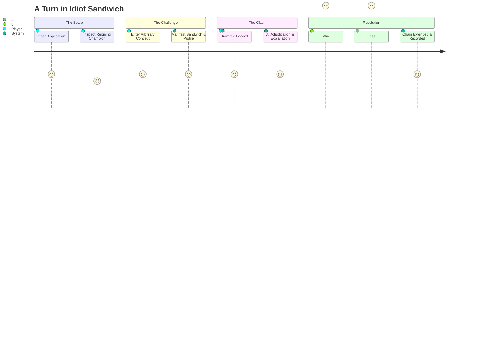

# IDIOT SANDWICH — Gameplay Mechanics

> Step-by-step description of the user journey, turn progression, battle resolution, and lineage tracking.

---

## 🎮 The Player Experience Lifecycle



---

## 1. Starting State

When a player launches the game:

1. **Reigning Champion Card:**
   - Displayed prominently in the center/upper quadrant.
   - Shows the champion's sandwich portrait (e.g., an oozing *Onion Sandwich* with golden toast).
   - Displays champion statistics: Title, reign length (defenses won), and key comedic attributes.
   - *Default state on game inception:* A canonical starter champion (e.g., "The Humble Onion Sandwich").
2. **The Challenge Arena / Input Bar:**
   - An inviting, high-contrast input box: *"What will challenge the champion?"*
   - Contextual placeholder suggestions that rotate dynamically: *"e.g., A rusty tractor, Supernova, A bad hair day, Gandhi..."*
3. **The Lineage Chain (Breadcrumb Timeline):**
   - A visual reel showing past victorious sandwiches that held the crown during this session or global run.

---

## 2. Input Phase

- The player submits an arbitrary text string via input field or speech-to-text.
- Inputs can range from single nouns (`toaster`) to compound descriptors (`a toaster with an attitude problem`) to conceptual abstractions (`the feeling of stepping on a Lego`).
- Client-side pre-flight checks verify length (e.g., max 120 characters) and sanitize formatting before transmission to the backend.

---

## 3. Interpretation & Sandwich Manifestation

Once submitted, the game initiates dual resolution:

1. **Semantic Resolution:** The input is classified, assigning canonical names, conceptual domains (Physical, Cosmic, Abstract, Biological), and comparative power tiers (see [AI_SYSTEM.md](./AI_SYSTEM.md)).
2. **Visual Manifestation:** The entity is converted into a sandwich aesthetic.
   - A toaster becomes two slices of toasted white bread clamping an electric heating coil and crumb tray.
   - A black hole becomes two glowing accretion-disk brioche buns warping cosmic light around a void filling.
   - Image rendering handles caching so identical submissions load instantaneously (see [IMAGE_SYSTEM.md](./IMAGE_SYSTEM.md)).

---

## 4. The Battle (The Clash)

The screen transitions into a confrontation view:

- **Versus Layout:** The reigning champion on the left/top; the challenger on the right/bottom.
- **Tension Phase:** A rapid comedic standoff animation (bread vibrating, sparks flying, sauce splashing).
- **Matchup Evaluation:** The engine queries the adjudication service with the champion and challenger profiles.

---

## 5. Result & Narrative

The battle resolves with a punchy, decisive climax:

- **Victory Screen / Defeat Screen:**
  - Clear declaration of the winner.
  - An AI-authored, humorous rationale (e.g., *"The Nuclear Bomb Sandwich detonates with 50 megatons of flavor, completely atomizing the Car Sandwich, though leaving the rye bread surprisingly crispy."*).
- **Attribute Breakdown:** Humorous comparative metric callouts (e.g., Destructive Force: 10 vs. 9999).

---

## 6. The Champion Chain

The game's progression is recorded as an evolving evolutionary tree or linear chain of supremacy.

```text
🧅 Onion Sandwich (Reign: 0 defenses)
      ↓ (Defeated by Car)
🚗 Car Sandwich (Reign: 1 defense)
      ↓ (Defeated by Nuclear Bomb)
☢️ Nuclear Bomb Sandwich (Reign: 3 defenses)
      ↓ (Defeated by Black Hole)
🕳️ Black Hole Sandwich (Reign: Active Champion)
```

### When the Challenger Wins:
1. The challenger is crowned the **New Champion**.
2. Its sandwich card slides into the reigning throne position.
3. The chain advances by one node.
4. The defense counter resets to 0.
5. The player is invited to introduce the next challenger to topple their new king.

### When the Challenger Loses:
1. The reigning champion **retains the crown**.
2. The champion's defense counter increments by +1 (e.g., *"Defenses: 4"*).
3. The defeated challenger is marked as a "Defeated Contender" in the turn history.
4. The player is challenged to think bigger, weirder, or more counter-intuitive to dethrone the champ.

---

## 🔗 Related Documentation

- The conceptual framework: [GAME_RULES.md](./GAME_RULES.md)
- Engine execution pipeline: [GAME_ENGINE.md](./GAME_ENGINE.md)
- User interface and animations: [UI_UX.md](./UI_UX.md)
- Data structures for turns & chains: [DATA_MODEL.md](./DATA_MODEL.md)
