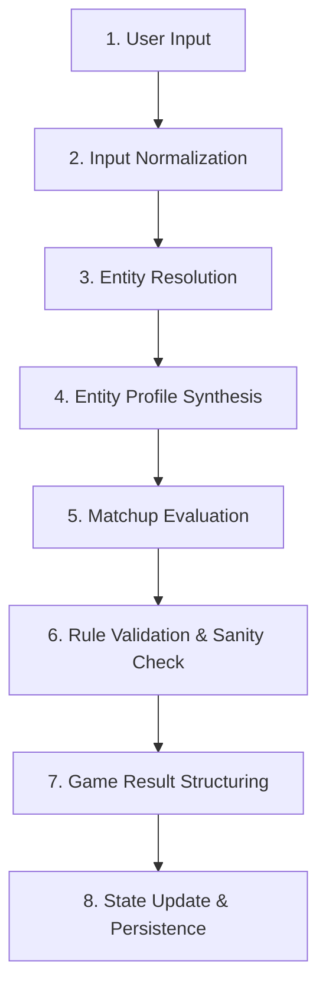

# IDIOT SANDWICH — Game Engine Architecture

> Technical specification of the entity lifecycle, evaluation pipeline, attribute concepts, and scoring models.

---

## ⚙️ The Engine Execution Pipeline

The core game engine enforces a clean separation of concerns. Raw natural language is never directly injected into game state or database tables. Every turn traverses an 8-stage pipeline:



### Stage Breakdown

| Stage | Responsibility | Primary Component |
| :--- | :--- | :--- |
| **1. User Input** | Captures raw client text, validates length and character bounds. | API Boundary |
| **2. Input Normalization** | Trims, strips HTML/control characters, fixes capitalization, checks moderation. | Security / Sanitizer |
| **3. Entity Resolution** | Resolves alias/canonical name, checks entity database/cache for prior instances. | Data Store / Cache |
| **4. Entity Profile Synthesis** | Derives semantic attributes (scale, power, domain) via AI interpreter or cache. | AI Interpreter |
| **5. Matchup Evaluation** | Compares Champion profile vs. Challenger profile to determine victor and rationale. | Evaluator (AI + Engine) |
| **6. Rule Validation** | Asserts invariant rules (e.g., non-null winner, schema compliance, confidence thresholds). | Game Engine Core |
| **7. Game Result Structuring** | Constructs immutable turn record with scores, rationale, and timestamps. | Engine Formatter |
| **8. State Update** | Commits turn to database, updates active champion pointer if winner = challenger. | Persistence Service |

---

## 📊 Entity Attributes & Power Dimensions (Proposed)

To prevent matchups from being purely subjective hallucinations, entities can be characterized along multiple candidate dimensions:

```text
┌────────────────────────────────────────────────────────┐
│                   ENTITY PROFILE                       │
├──────────────────────────┬─────────────────────────────┤
│ Dimension                │ Conceptual Range / Meaning  │
├──────────────────────────┼─────────────────────────────┤
│ Scale                    │ Subatomic → Planetary →     │
│                          │ Multiversal                 │
│ Destructive Potential    │ Negligible → Cataclysmic    │
│ Durability / Resilience  │ Fragile → Indestructible    │
│ Speed / Velocity         │ Immobile → Lightspeed       │
│ Conceptual / Magic Tier  │ Mundane Physical → Abstract │
│ Absurdity / Humor Index  │ Grounded → Completely Wild  │
│ Specific Weaknesses      │ e.g., Water, Logic, Irony   │
└──────────────────────────┴─────────────────────────────┘
```

*Status: **PROPOSED** — The final set of dimensions is subject to balancing during Phase 0.2.*

---

## ⚖️ Evaluation & Scoring Approaches (Under Evaluation)

A critical open architectural question is how much the engine relies on **pure LLM judgment** versus **deterministic algorithmic scoring**:

### Option A: Pure AI Evaluator (Semantic Prompting)
- **Mechanism:** Both entity profiles are formatted into a prompt; an LLM determines the victor and explains why in a single structured JSON response.
- **Pros:** Maximum flexibility, natural appreciation for irony, context, and poetic counters (e.g., "water defeats sponge").
- **Cons:** Risk of non-deterministic edge cases, prompt sensitivity, potential evaluation drift across model versions.

### Option B: Hybrid Score + AI Flavor (Attribute Arithmetic + AI Narrative)
- **Mechanism:** The engine computes a composite power index (e.g., `Score = (Scale * 0.4) + (Destruction * 0.4) + (Durability * 0.2) + AdvantageModifiers`). The AI is invoked only to generate the humorous narrative based on the pre-calculated winner.
- **Pros:** 100% deterministic, easy to test, zero chance of inconsistent winners for identical stats.
- **Cons:** Rigid and formulaic; struggles with conceptual or ironic victories (e.g., a "paper" defeating a "rock" without hardcoded exceptions).

### Option C: AI Adjudication with Rule-Engine Overrides (Recommended Hybrid)
- **Mechanism:** The AI evaluates the matchup and returns a structured decision (`winner`, `confidence`, `reason`, `keyFactors`). The engine then passes the decision through a sanity check layer:
  - If identical matchup exists in history cache → return cached winner.
  - If confidence is extremely low or malformed → trigger tie-breaker rules.
  - If challenger is a known direct counter → apply deterministic multiplier.
- **Pros:** Combines infinite semantic flexibility with deterministic guardrails.
- **Cons:** Slightly higher engineering complexity in validation layer.

> **Decision Status:** `PROPOSED (Option C)`. See [DECISIONS.md](./DECISIONS.md#dec-005) and [OPEN_QUESTIONS.md](./OPEN_QUESTIONS.md).

---

## 🛡️ Rule Validation & Sanity Verification

Before any result alters game state, the `Rule Validator` ensures:
1. **Winner Validity:** The declared winner must strictly be `"champion"` or `"challenger"`. Draws are resolved or rejected by engine policy.
2. **Confidence Threshold:** If the AI confidence is below an acceptable threshold (e.g., `< 0.50`), the engine applies a fallback resolution rule.
3. **No Self-Mutating Game State:** The AI cannot inject new rules, alter past turn records, or bypass turn increments.

---

## 🔗 Related Documentation

- AI orchestration and prompt specs: [AI_SYSTEM.md](./AI_SYSTEM.md)
- Schema definitions: [DATA_MODEL.md](./DATA_MODEL.md)
- Game rules: [GAME_RULES.md](./GAME_RULES.md)
- Key architectural decisions: [DECISIONS.md](./DECISIONS.md)
