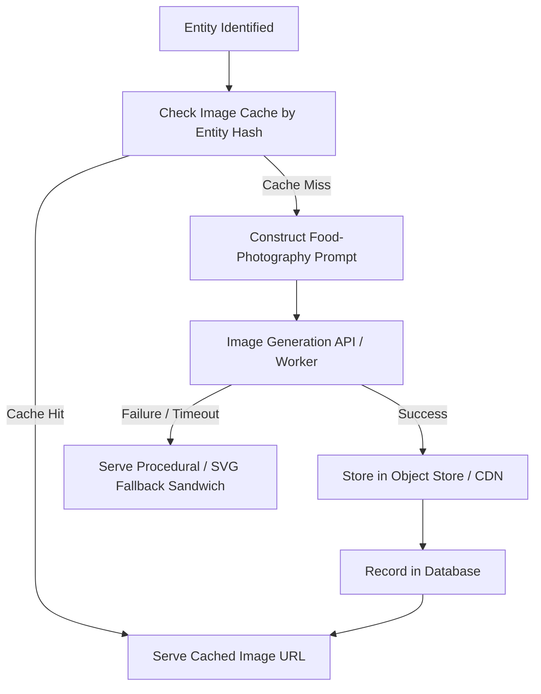

# IDIOT SANDWICH — Image Generation System

> Architecture and operational strategy for turning arbitrary concepts into culinary sandwich monstrosities.

---

## 🥪 Core Concept: Everything is a Sandwich

The defining aesthetic of IDIOT SANDWICH is literal and absurd: **no matter what the player enters, it must be represented visually as a sandwich.**

```text
🚗 Car
  → Car Sandwich: Slices of buttered sourdough clamping engine blocks, chrome bumpers, and motor oil aioli.

☢️ Nuclear Bomb
  → Nuclear Bomb Sandwich: Glowing radioactive brioche buns squeezing a fissile warhead core with neon relish.

🕳️ Black Hole
  → Black Hole Sandwich: Warped space-time crusts bending light around an infinite void filling.

🐘 Elephant
  → Elephant Sandwich: Massive artisan rye slices pinching a pair of gentle ivory tusks and safari foliage garnish.
```

---

## 🎨 Image Generation Pipeline



---

## 📝 Prompt Generation Architecture

To ensure high visual quality and thematic consistency, user inputs are never passed raw to the image model. Prompts are constructed via a templated style guide:

```text
[Subject Representation] sandwiched between two [Bread/Bun Type],
gourmet commercial studio food photography, dramatic rim lighting,
hilariously absurd culinary presentation, extreme detail, 8k resolution,
crispy crust, mouth-watering yet completely impossible sandwich filling.
```

- **Negative Prompts / Guardrails:** Avoid human hands holding the sandwich, avoid standard burgers unless specified, avoid generic stock graphics.
- **Dynamic Flavor Tags:** The entity's domain dictates the bread type (e.g., Industrial entities get toasted metal rye; Cosmic entities get glowing nebulous brioche).

---

## ⚡ Latency & Loading States

Image generation models can take between 2 to 10 seconds to generate a picture. Because fast gameplay is a core objective, the frontend and API must manage this latency gracefully:

1. **Optimistic Gameplay Resolution:**
   - The battle text and winner declaration can resolve rapidly (sub-second or 1–2s via LLM).
   - The challenger card shows a dynamic "Building Sandwich..." animated placeholder (pulsing grill marks, rising steam, or slice-drop animation) while the visual renders.
2. **Skeleton & Shimmer States:**
   - Visually engaging bread-themed loaders prevent the UI from feeling frozen.
3. **Pre-warming / Canonical Library:**
   - Common starter entities (`Onion`, `Brick`, `Sword`, `Sun`) have pre-rendered images baked into the repository assets.

---

## 💾 Caching, Persistence & Entity Identity

Because image generation is the single largest cost driver (see [COSTS.md](./COSTS.md)), aggressive caching is mandatory:

- **Entity Normalization Key:** Submissions are hashed based on canonicalized name and category (e.g., `hash("car") == hash("automobile")`).
- **Object Storage Persistence:** Once generated, images are stored in permanent object storage (e.g., S3/R2/Cloud Storage) and served via CDN.
- **Cache Hit Rate:** Over time, popular submissions will load in `<50ms` from CDN with zero generation cost.
- **Regeneration Policy:** Only admins or explicit game event resets should trigger a re-roll of an existing entity's artwork.

---

## 🛑 Fallback Behavior & Error Handling

If the generation provider experiences outages, timeouts, or content filter rejections:

1. **Tier 1 — Curated Archetype Fallbacks:** The game maps the entity category (e.g., `Vehicle`, `Animal`, `Cosmic`) to a curated fallback sandwich vector/illustration.
2. **Tier 2 — Procedural "Mystery Meat" Sandwich:** A dynamic canvas-rendered minimalist sandwich card displaying the entity name stamped on toasted bread with humorous apology copy.
3. **No Game Blockers:** A missing image must **never** prevent battle evaluation or progression. The game engine resolves turns independently of visual rendering.

---

## 🛡️ Moderation & Safety in Visuals

- Inputs flagged by safety checks are prevented from dispatch to image generation models.
- Avoid wasting API credits or generating non-compliant content on adversarial inputs.
- Provider-level safety filters must be monitored for error codes (`NSFW_DETECTED`, `SAFETY_VIOLATION`) and handled gracefully.

---

## 🔗 Related Documentation

- Cost mitigation strategies: [COSTS.md](./COSTS.md)
- Data model for generated images: [DATA_MODEL.md](./DATA_MODEL.md)
- UI presentation and card animations: [UI_UX.md](./UI_UX.md)
- Security & abuse prevention: [SECURITY.md](./SECURITY.md)
