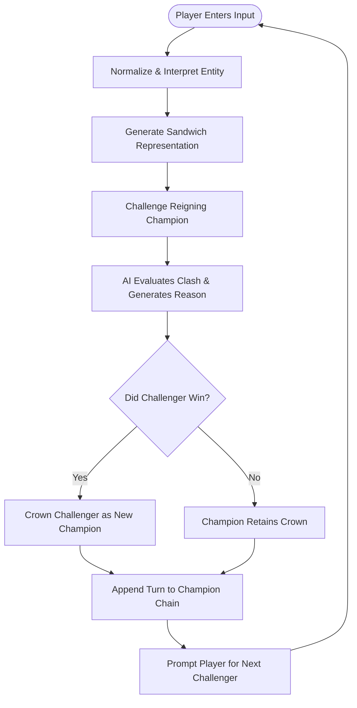

# IDIOT SANDWICH — Project Overview

> High-level vision, core gameplay loop, target feeling, and architectural non-goals for the Idiot Sandwich universe.

---

## 🎯 Vision

**IDIOT SANDWICH** is an absurd, AI-assisted competitive object game. It strips away complicated gaming conventions and focuses on a single compelling dynamic: **"What if your weirdest idea was turned into a sandwich and had to fight another sandwich?"**

Rather than picking from a locked catalog of 50 pre-rendered characters or repeating standard RPS (Rock-Paper-Scissors) mechanics, players are granted an infinite canvas. Whether entering a pantry staple (`onion`), an engine of destruction (`nuclear bomb`), a cosmic phenomenon (`black hole`), an abstract notion (`the fear of missing out`), or a hyper-specific scenario (`a toaster that shoots guided missiles`), the system interprets the input, crafts a sandwich depiction, and pits it against the standing champion.

---

## 🔁 Core Experience

The foundational player loop is fast, immediate, and addictive:

### The Turn Loop in Detail

1. **Submission:** The player types any word, phrase, or concept.
2. **Interpretation:** The game engine parses and normalizes the concept into an active entity profile (see [GAME_ENGINE.md](./GAME_ENGINE.md) and [AI_SYSTEM.md](./AI_SYSTEM.md)).
3. **Sandwich Incarnation:** The entity is manifested visually as a culinary monstrosity (see [IMAGE_SYSTEM.md](./IMAGE_SYSTEM.md)).
4. **The Duel:** The challenger challenges the current champion sandwich.
5. **Adjudication:** The engine—assisted by structured LLM evaluation—resolves the matchup, judging scale, inherent properties, humor, and counters.
6. **Resolution & Narrative:** The game displays the outcome alongside a sharp, comedic, punchy explanation.
7. **Crown Handover:** If victorious, the challenger becomes the new benchmark for all subsequent turns. If defeated, the current champion remains undefeated.

---

## 🎭 Target Feeling

The game is designed to evoke a specific emotional resonance:

- **Absurd & Unhinged:** Embraces internet humor and culinary surrealism.
- **Fast & Responsive:** Minimal friction between thought, typing, and resolution.
- **Comedic & Punchy:** Explanations and visuals prioritize amusement over clinical combat logs.
- **Unpredictable Yet Rationalized:** Unexpected matchups occur, but the AI always delivers a coherent, funny defense of the result.
- **Visually Striking:** The sandwich artwork transforms mundane or terrifying concepts into appetizingly ridiculous creations.
- **Compulsively Replayable:** Simple enough to play for 30 seconds; strange enough to play for an hour trying to dethrone a resilient champion.

---

## 🚫 Non-Goals

To maintain clarity of scope and prevent project bloat, IDIOT SANDWICH is explicitly **NOT**:

1. **Not a Traditional RPG:** No grinding, inventory management, stat trees, equipment slots, or leveling up.
2. **Not a Conventional Fighting Game:** No frames, combos, active collision mechanics, or real-time reflexes.
3. **Not a Hardcoded Rock-Paper-Scissors Clone:** No static 3-way or 5-way lookup matrices (e.g., Fire beats Grass). Evaluation is dynamic.
4. **Not a Realistic Physics Simulator:** Real-world physics serve as inspiration for comedic arguments, not rigid mathematical simulations.
5. **Not a Freeform AI Chatbot:** The player is not conversing with a conversational assistant. AI is an internal adjudication engine providing structured responses.
6. **Not an Overengineered MMO/Social Network:** The initial MVP focuses on pristine single-player / shared-champion session mechanics, omitting friend graphs, guild mechanics, or live chat.

---

## 🔗 Related Documentation

- Detailed player mechanics: [GAMEPLAY.md](./GAMEPLAY.md)
- Conceptual rules: [GAME_RULES.md](./GAME_RULES.md)
- Architectural blueprints: [ARCHITECTURE.md](./ARCHITECTURE.md)
- Current roadmap: [ROADMAP.md](./ROADMAP.md)
