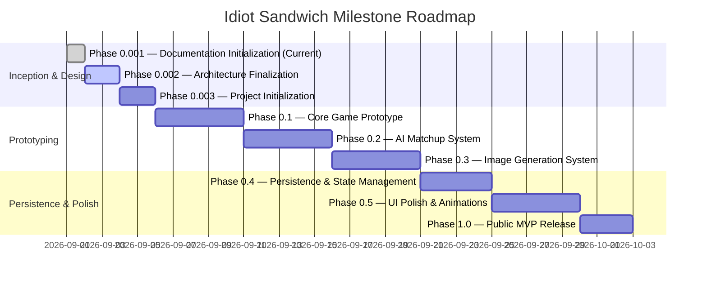

# IDIOT SANDWICH — Development Roadmap

> Phased milestone trajectory from documentation initialization to public release.

---

## 🗺️ Roadmap Overview

---

## 📍 Phased Milestones

### Phase 0.001 — Documentation Initialization 🟢 *(CURRENT)*
- **Objective:** Establish a comprehensive, clean architectural and conceptual documentation baseline.
- **Deliverables:** Complete `/docs` architecture specifications, conceptual rules, data models, and API blueprints.
- **Constraints:** Zero application code, no database migrations, no third-party SDK installations.

---

### Phase 0.002 — Architecture & Decision Finalization 🟡 *(UPCOMING)*
- **Objective:** Resolve critical open design questions regarding AI evaluation strategies and provider choices.
- **Key Tasks:**
  - Select primary LLM provider and structured output engine.
  - Settle evaluation scoring methodology (Pure AI vs. Rule-Engine Hybrid).
  - Select image generation provider and storage CDN partner.
  - Finalize database hosting provider.

---

### Phase 0.003 — Project Initialization
- **Objective:** Scaffold the technical repository foundation.
- **Key Tasks:**
  - Initialize Next.js project with TypeScript, ESLint, and Prettier.
  - Configure Tailwind / Vanilla CSS design tokens.
  - Set up environment variable schemas and config validation.
  - Configure initial test harness (Vitest / Playwright).

---

### Phase 0.1 — Core Game Prototype (Mock Engine)
- **Objective:** Deliver a playable client-side loop with mocked AI and static sandwich visuals.
- **Key Tasks:**
  - Implement the Arena interface and input bar.
  - Implement deterministic turn loop with hardcoded/mocked matchups.
  - Validate state transitions (Champion dethroning, lineage tracking).

---

### Phase 0.2 — AI Matchup System Integration
- **Objective:** Connect the live LLM service for structured semantic adjudication.
- **Key Tasks:**
  - Integrate LLM client with structured Zod response schema.
  - Implement prompt templates for classification and comedic reasoning.
  - Implement prompt injection mitigations and basic content moderation.

---

### Phase 0.3 — Image Generation & Asset Pipeline
- **Objective:** Bring sandwich visuals to life dynamically.
- **Key Tasks:**
  - Integrate image generation API with food-photography prompt templates.
  - Implement image caching and CDN upload pipelines.
  - Add fallback placeholders and optimistic loading states.

---

### Phase 0.4 — Database Persistence & Session History
- **Objective:** Persist games, turns, and champion lineages to PostgreSQL.
- **Key Tasks:**
  - Deploy PostgreSQL database and Drizzle ORM schema migrations.
  - Implement `/api/game` and `/api/game/:id/challenge` endpoints.
  - Enable persistent shareable game links and global lineage reels.

---

### Phase 0.5 — UI Polish, Animations & Audio
- **Objective:** Elevate visual and sensory experience to "wow" standard.
- **Key Tasks:**
  - Implement bread-slam collision animations, particle effects, and screen shakes.
  - Add comedic sound effects (crunch, sizzle, explosion, victory fanfare).
  - Perfect responsive mobile layouts.

---

### Phase 1.0 — Public MVP Release
- **Objective:** Launch public-facing version of Idiot Sandwich.
- **Key Tasks:**
  - Production rate-limiting and cost guardrails deployed.
  - Analytics and performance monitoring enabled.
  - Public release on custom domain.

---

## 🔗 Related Documentation

- Project vision: [PROJECT.md](./PROJECT.md)
- Architectural decisions: [DECISIONS.md](./DECISIONS.md)
- Outstanding questions: [OPEN_QUESTIONS.md](./OPEN_QUESTIONS.md)
