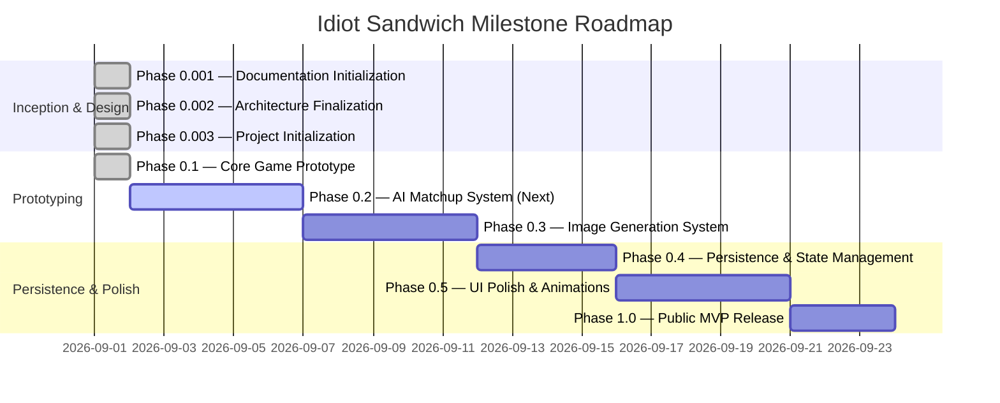

# IDIOT SANDWICH — Development Roadmap

> Phased milestone trajectory from documentation initialization to public release.

---

## 🗺️ Roadmap Overview

---

## 📍 Phased Milestones

### Phase 0.001 — Documentation Initialization 🟢 *(COMPLETED)*
- **Objective:** Establish a comprehensive, clean architectural and conceptual documentation baseline.
- **Deliverables:** Complete `/docs` architecture specifications, conceptual rules, data models, and API blueprints.
- **Constraints:** Zero application code, no database migrations, no third-party SDK installations.

---

### Phase 0.002 — Architecture Finalization 🟢 *(COMPLETED)*
- **Objective:** Resolve critical open design questions regarding AI evaluation strategies and provider choices.
- **Outcomes:**
  - Standardized on **Google Gemini 1.5 Flash** for low-latency structured JSON evaluation ([DEC-010](./DECISIONS.md#dec-010)).
  - Adopted **Option C: Hybrid AI + Rule Guardrails** for matchup resolution ([DEC-011](./DECISIONS.md#dec-011)).
  - Adopted **Cache-First + Async Winner Generation** with stylized placeholders ([DEC-013](./DECISIONS.md#dec-013)).
  - Standardized on **Neon Serverless PostgreSQL + Drizzle ORM** ([DEC-012](./DECISIONS.md#dec-012)).
  - Confirmed **Next.js (App Router) + TypeScript** stack ([DEC-007](./DECISIONS.md#dec-007)).

---

### Phase 0.003 — Project Initialization 🟢 *(COMPLETED)*
- **Objective:** Scaffold the technical repository foundation.
- **Deliverables:**
  - Next.js (App Router) + TypeScript project with ESLint.
  - Core vanilla CSS design system and tokens in `globals.css`.
  - Minimal hand-drawn notebook paper theme (`#F7F4EA`).
  - Environment variable schema in `.env.example`.
  - Clean production build and linting checks passed.

---

### Phase 0.1 — Core Game Prototype (Mock Engine) 🟢 *(COMPLETED)*
- **Objective:** Deliver a playable client-side loop with mocked AI and static sandwich visuals.
- **Deliverables:**
  - Semantic mock adjudicator (`src/lib/engine/mock-adjudicator.ts`) with entity normalization, categories, and contextual counter rules.
  - Complete duel staging: input locks, handwritten loading messages, confrontation clash phase, and humorous verdict presentation.
  - Defense streak tracking and collapsible notebook battle history drawer.
  - Unit test suite (`npm test`) with 100% passing tests for normalization, counters, and scale advantages.

---

### Phase 0.2 — AI Matchup System Integration 🟡 *(NEXT)*
- **Objective:** Connect the live Google Gemini 1.5 Flash service for structured semantic adjudication.

---

### Phase 0.2 — AI Matchup System Integration
- **Objective:** Connect the live LLM service for structured semantic adjudication.
- **Key Tasks:**
  - Integrate Gemini 1.5 Flash client with structured Zod response schema.
  - Implement prompt templates for classification and comedic reasoning.
  - Implement prompt injection mitigations and basic content moderation.

---

### Phase 0.3 — Image Generation & Asset Pipeline
- **Objective:** Bring sandwich visuals to life dynamically.
- **Key Tasks:**
  - Integrate image generation API with food-photography prompt templates.
  - Implement image caching and CDN upload pipelines.
  - Add fallback placeholders and optimistic loading states.

---

### Phase 0.4 — Database Persistence & Session History
- **Objective:** Persist games, turns, and champion lineages to Neon PostgreSQL.
- **Key Tasks:**
  - Deploy PostgreSQL database and Drizzle ORM schema migrations.
  - Implement `/api/game` and `/api/game/:id/challenge` endpoints.
  - Enable persistent shareable game links and global lineage reels.

---

### Phase 0.5 — UI Polish, Animations & Audio
- **Objective:** Elevate visual and sensory experience to "wow" standard.
- **Key Tasks:**
  - Implement bread-slam collision animations, particle effects, and screen shakes.
  - Add comedic sound effects (crunch, sizzle, explosion, victory fanfare).
  - Perfect responsive mobile layouts.

---

### Phase 1.0 — Public MVP Release
- **Objective:** Launch public-facing version of Idiot Sandwich.
- **Key Tasks:**
  - Production rate-limiting and cost guardrails deployed.
  - Analytics and performance monitoring enabled.
  - Public release on custom domain.

---

## 🔗 Related Documentation

- Project vision: [PROJECT.md](./PROJECT.md)
- Architectural decisions: [DECISIONS.md](./DECISIONS.md)
- Outstanding questions: [OPEN_QUESTIONS.md](./OPEN_QUESTIONS.md)
