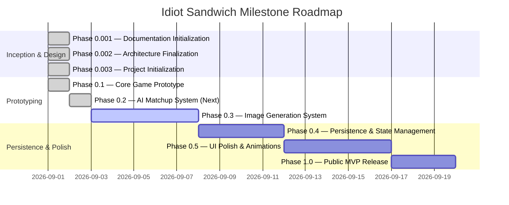

# IDIOT SANDWICH — Development Roadmap

> Phased milestone trajectory from documentation initialization to public release.

---

## 🗺️ Roadmap Overview

---

## 📍 Phased Milestones

### Phase 0.001 — Documentation Initialization 🟢 *(COMPLETED)*
- **Objective:** Establish a comprehensive, clean architectural and conceptual documentation baseline.
- **Deliverables:** Complete `/docs` architecture specifications, conceptual rules, data models, and API blueprints.
- **Constraints:** Zero application code, no database migrations, no third-party SDK installations.

---

### Phase 0.002 — Architecture Finalization 🟢 *(COMPLETED)*
- **Objective:** Resolve critical open design questions regarding AI evaluation strategies and provider choices.
- **Outcomes:**
  - Standardized on **Google Gemini 1.5 Flash** for low-latency structured JSON evaluation ([DEC-010](./DECISIONS.md#dec-010)).
  - Adopted **Option C: Hybrid AI + Rule Guardrails** for matchup resolution ([DEC-011](./DECISIONS.md#dec-011)).
  - Adopted **Zero-DB Architecture** ([DEC-014](./DECISIONS.md#dec-014)): Ephemeral in-memory session progression with zero database overhead.
  - Confirmed **Next.js (App Router) + TypeScript** stack ([DEC-007](./DECISIONS.md#dec-007)).

---

### Phase 0.003 — Project Initialization 🟢 *(COMPLETED)*
- **Objective:** Scaffold the technical repository foundation.
- **Deliverables:**
  - Next.js (App Router) + TypeScript project with ESLint.
  - Core vanilla CSS design system and tokens in `globals.css`.
  - Minimal hand-drawn notebook paper theme (`#F7F4EA`).
  - Environment variable schema in `.env.example`.
  - Clean production build and linting checks passed.

---

### Phase 0.1 — Core Game Prototype (Mock Engine) 🟢 *(COMPLETED)*
- **Objective:** Deliver a playable client-side loop with mocked AI and static sandwich visuals.
- **Deliverables:**
  - Semantic mock adjudicator (`src/lib/engine/mock-adjudicator.ts`) with entity normalization, categories, and contextual counter rules.
  - Complete duel staging: input locks, handwritten loading messages, confrontation clash phase, and humorous verdict presentation.
  - Defense streak tracking and collapsible notebook battle history drawer.
  - Unit test suite (`npm test`) with 100% passing tests for normalization, counters, and scale advantages.

---

### Phase 0.2 — AI Matchup System Integration 🟢 *(COMPLETED)*
- **Objective:** Connect the live Google Gemini service for structured semantic adjudication with safety boundaries and deterministic fallback.
- **Deliverables:**
  - `@google/genai` client integration with candidate model fallback (`gemini-3.5-flash-lite`, `gemini-flash-latest`, etc.).
  - Rigid structured JSON schema validation via Zod (`src/lib/engine/schemas.ts`) enforcing `winner`, `confidence`, `shortHeadline`, `humorousReason`, `dominantFactor`, and `challengerProfile`.
  - Input sanitizer and security moderation layer (`src/lib/security/sanitizer.ts`) defending against prompt injection and toxic terms.
  - Hybrid adjudication engine with Option C fallback (`src/lib/engine/gemini-adjudicator.ts`) to ensure 100% offline/dev reliability.
  - Next.js server route handler (`POST /api/challenge`) isolating credentials from client bundle.
  - UI integration in `src/app/page.tsx` with live referee indicator, loading interval cycling, and in-game safety warning cards.
  - Unit test suite expanded to 11 tests across engine, schemas, and security sanitizer.

---

### Phase 0.3 — Procedural Sandwich Visual System 🟢 *(COMPLETED)*
- **Objective:** Render every submitted entity as a hilarious sandwich with zero latency and zero token costs.
- **Deliverables:**
  - Dynamic CSS/SVG sandwich card architecture with bread buns, pickles, cheese tabs, custom filling colors, and emoji centers.
  - Curated photorealistic sandwich assets for archetypes (`onion`, `car`, `nuclear`, `water_balloon`).
  - Zero token burn ($0.00/turn image cost) and 0ms rendering latency.

---

### Phase 0.4 — Session Durability & Shareable Cards (Zero-DB) 🟢 *(COMPLETED)*
- **Objective:** Client session durability and shareable brag cards without database infrastructure.
- **Deliverables:**
  - Automated `localStorage` session save and hydration (protecting runs across browser refreshes).
  - One-click **"📋 Share"** brag card generator copying formatted summaries to clipboard and native mobile sharing.
  - Collapsible **"📜 History"** receipt drawer tracking all battles, winners, and AI punchlines in the run.
  - **"🔄 Reset"** control with inline confirmation to start fresh back at Round 1.

---

### Phase 0.5 — UI Polish, Animations & Audio
- **Objective:** Elevate visual and sensory experience to "wow" standard.
- **Key Tasks:**
  - Implement bread-slam collision animations, particle effects, and screen shakes.
  - Add comedic sound effects (crunch, sizzle, explosion, victory fanfare).
  - Perfect responsive mobile layouts.

---

### Phase 1.0 — Public MVP Release
- **Objective:** Launch public-facing version of Idiot Sandwich.
- **Key Tasks:**
  - Production rate-limiting and cost guardrails deployed.
  - Analytics and performance monitoring enabled.
  - Public release on custom domain.

---

## 🔗 Related Documentation

- Project vision: [PROJECT.md](./PROJECT.md)
- Architectural decisions: [DECISIONS.md](./DECISIONS.md)
- Outstanding questions: [OPEN_QUESTIONS.md](./OPEN_QUESTIONS.md)
